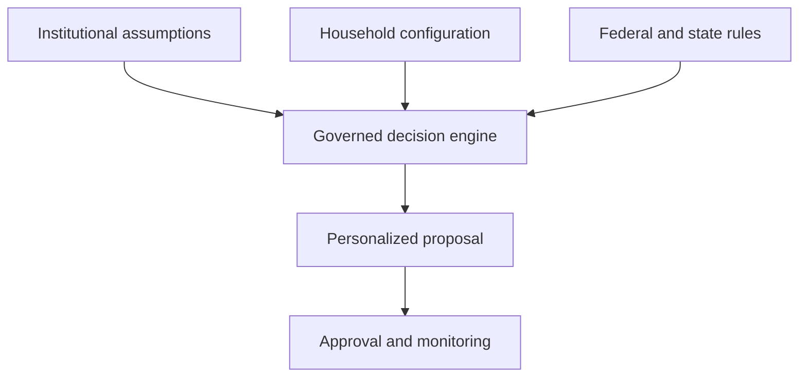

# Household Decision Intelligence

## Competitive Positioning and Defensibility Strategy

**Status:** Strategic companion to the Household Decision Intelligence Master Product Specification  
**Version:** 0.1  
**Date:** August 8, 2026

---

## 1. Executive conclusion

The proposed Household Decision Intelligence platform addresses a large and consequential problem, but the broad concept is not unique by itself. Existing financial-planning and wealth-technology companies already offer combinations of holistic household planning, deterministic calculations, AI-assisted workflows, personalized recommendations, proposals, monitoring, and advisor-scale delivery.

The platform should therefore not claim to be the first AI financial planner or the first holistic planning platform. Its strongest potential position is narrower and more defensible:

> The governed, state-aware household capital decision engine for complex financial lives.

The differentiated product would not merely project financial outcomes or illustrate scenarios. It would solve constrained household allocation decisions; identify binding constraints and opportunity costs; integrate federal and effective-dated 50-state rules; translate institutional assumptions into household-specific actions; preserve a complete decision audit trail; and continuously monitor whether an approved decision remains valid.

### Assessment

| Dimension | Assessment |
|---|---:|
| Problem importance | 9/10 |
| Addressable market breadth | 9/10 |
| Current conceptual uniqueness | 4/10 |
| Potential differentiated position | 8/10 |
| Technical difficulty | 9/10 |
| Regulatory and domain difficulty | 9/10 |
| Defensibility if executed deeply | 8/10 |
| Defensibility as an AI interface alone | 2/10 |

The opportunity is real, but it depends on specialization and execution rather than category novelty.

---

## 2. Competitive reality

### Conquest Planning: closest institutional-planning analogue

Conquest Planning is the closest visible competitor to the proposed advisor and enterprise architecture. It describes an AI expert system that analyzes the client’s complete financial picture, evaluates many strategies, ranks actionable recommendations, and produces deterministic, auditable, repeatable results. Its platform spans goals-based and cash-flow planning, debt, estate, business, and broader household needs. Conquest also positions the product as a way to serve more clients while retaining professional control and compliance traceability.[^conquest-platform][^conquest-faq]

Implication:

> “AI orchestrates; deterministic tools handle the math” is a sound design principle, but it is not a unique market claim.

Conquest must be treated as a direct benchmark for calculation governance, recommendation traceability, plan-generation speed, professional workflows, and enterprise distribution.

### Origin: closest consumer financial-command-center analogue

Origin presents itself as an integrated personal-finance platform spanning spending, investments, retirement, taxes, account visibility, forecasting, and conversational advice. Its public positioning describes multi-agent orchestration, deterministic mathematical engines, persistent financial context, compliance controls, and ongoing guidance.[^origin-comparison][^origin-overview]

Because these claims come from Origin itself, their depth and performance require independent testing. Strategically, however, Origin occupies much of the consumer narrative the proposed platform might otherwise claim:

- Full financial picture rather than one account.
- Conversation rather than dashboards alone.
- Forward-looking decisions rather than historical categorization.
- Deterministic calculations beneath AI interaction.
- Continuous context and guidance.

### Quinn: closest embedded, scalable-advice analogue

Quinn offers embedded AI-driven financial planning for banks, fintechs, RIAs, and wealth managers. It positions itself as a fiduciary infrastructure provider that can generate detailed, actionable plans and expand planning coverage without requiring institutions to build their own registered advisory capability.[^quinn]

Implication:

The promise of personalized advice at scale, without proportional advisor headcount, is already becoming a contested category.

### Established financial-planning platforms

Incumbents already support much of the “whole picture”:

- eMoney markets goals-based and cash-flow planning across clients’ financial lifecycles, including complex tax and estate needs.[^emoney]
- RightCapital supports retirement, tax, insurance, education, budgeting, debt, student loans, estate planning, stock plans, Monte Carlo analysis, and scenario comparison.[^rightcapital-features][^rightcapital-modules]
- Holistiplan specializes in systematized tax planning, scenario analysis, Roth planning, and state-specific observations.[^holistiplan]
- TIFIN develops AI products across wealth management, tax intelligence, workplace wealth, advisor operations, and personalized engagement.[^tifin]

The platform cannot rely on “we understand the entire household” as its primary differentiator. That is already the aspiration of traditional and emerging competitors.

---

## 3. Where genuine differentiation can exist

### 3.1 Household capital allocation as the primary mathematical problem

Most financial-planning platforms forecast outcomes, compare scenarios, or test whether goals appear feasible. The proposed product can go further by explicitly solving the allocation of household resources across competing uses.

A general objective could be expressed as:

\[
\max_x \quad
\text{goal attainment}
+ \text{liquidity}
+ \text{resilience}
+ \text{option value}
- \text{taxes}
- \text{interest}
- \text{risk}
- \text{household burden}
\]

subject to:

- Conservation of cash and resources.
- Account contribution and distribution limits.
- Debt obligations and prepayment conditions.
- Federal and state rules.
- Benefit eligibility.
- Liquidity floors.
- Goal deadlines.
- Household preferences and fairness constraints.
- Institutional planning and product policies.
- Required professional and household approvals.

The distinctive outputs would be:

- The best current use of the next dollar.
- A multi-period sequence of capital actions.
- The household’s binding constraint.
- The marginal value of relaxing a constraint.
- Opportunity costs across goals.
- Pareto-efficient alternatives.
- Conditions under which the recommendation reverses.
- Stability ranges that prevent recommendation churn.

This would make the system closer to institutional optimization infrastructure than a conventional retirement projection tool.

### 3.2 Federal and 50-state decision intelligence

State complexity is a potential moat if implemented as an effective-dated, reviewed decision system—not a table of state tax rates.

Relevant domains include:

- Domicile and residency.
- Remote work, reciprocity, and income sourcing.
- Part-year residence.
- Retirement-income and Social Security treatment.
- 529 deductions, credits, eligible plans, and recapture.
- HSA conformity.
- Capital-gain, interest, and dividend taxation.
- Property taxes and homestead programs.
- Estate and inheritance taxes.
- Marital and community-property treatment.
- Insurance rules and state programs.
- Paid leave, childcare, education, disability, and other household benefits.

The moat is the complete operating system around those rules:

\[
\text{Defensibility}
= \text{authoritative sources}
+ \text{effective dates}
+ \text{expert review}
+ \text{golden tests}
+ \text{household integration}
+ \text{change monitoring}
\]

A state rule becomes commercially valuable only when the platform can identify which households and prior decisions are affected by a change.

### 3.3 Institutional policy translated into household action

The enterprise platform should allow authorized organizations to configure:

- Capital-market assumptions.
- Planning assumptions.
- Risk and liquidity policies.
- Approved product universes.
- Suitability and review thresholds.
- Allowed household overrides.
- Compliance and approval requirements.

These institutional configurations would be combined with household facts, goals, preferences, restrictions, and jurisdictional rules through governed decision tools.

This creates a bridge between a CIO’s approved framework and the household’s actual financial decisions.

### 3.4 Decision-validity monitoring

Conventional monitoring asks whether balances or goals changed. The proposed platform should monitor whether a prior decision remains valid.

Examples:

- A state rule changed.
- A household moved or began working in another state.
- Income or bonus probability changed.
- Liquidity fell below a protected floor.
- A benefit election or employer match changed.
- A previously recommended action became infeasible.
- Another strategy became materially superior.
- A forecast moved, but not enough to justify action.

Every alert should identify:

- What changed.
- Which assumption, rule, or constraint is affected.
- Why the decision may need review.
- The estimated materiality.
- The affected households and proposals.
- The required approval or professional workflow.

The product should minimize alert volume and maximize decision relevance.

### 3.5 End-to-end decision operations

The platform should own a governed decision lifecycle:

1. Detect or receive a decision.
2. Clarify the household’s intent.
3. Gather missing information.
4. Resolve applicable jurisdictions.
5. Retrieve authoritative rules and institutional assumptions.
6. Run deterministic calculations and governed models.
7. Generate feasible alternatives.
8. Explain trade-offs and uncertainty.
9. Create a personalized proposal.
10. Route review and approvals.
11. Monitor continued validity.
12. Measure the observed outcome.

The strategic category is therefore not merely financial-planning software. It is household financial decision infrastructure.

---

## 4. Recommended beachhead

### Target segment

Start with equity-compensated, variable-income, and multi-state professionals and their households.

These households commonly have:

- RSUs, options, ESPP shares, or concentrated employer equity.
- Bonuses, commissions, or other variable compensation.
- Multiple retirement and taxable accounts.
- Student debt or mortgages.
- Childcare, education, housing, or relocation goals.
- Residence and employment across different states.
- Significant taxes but insufficient complexity or wealth for family-office infrastructure.

### Initial promise

> Coordinate the household’s next capital decisions across equity compensation, taxes, liquidity, debt, retirement accounts, and major goals—with state-aware calculations and an auditable action plan.

### Why this segment

- Financial consequences are measurable.
- The household faces recurring decisions rather than one annual plan.
- State and employer complexity are relevant.
- Users can afford professional or software-assisted planning.
- Advisers and CPAs experience meaningful manual burden.
- The platform can demonstrate value without predicting individual securities.

---

## 5. Recommended go-to-market model

### Primary route: B2B2C

Potential distribution partners:

- Independent RIAs.
- Fee-only financial planners.
- CPA financial-planning firms.
- Equity-compensation specialists.
- Employer financial-wellness and executive-benefit programs.
- Regional banks and credit unions.

The advisor or CPA supplies trust, professional judgment, and distribution. The platform supplies research, deterministic analysis, proposals, monitoring, documentation, and exception management.

### Enterprise value proposition

> Serve substantially more planning households at the same or greater analytical depth without increasing preparation, rekeying, proposal, monitoring, and documentation work proportionally.

This claim must be validated through measured preparation time, manual handoffs, rework, exception rates, reviewer capacity, and material errors.

### Consumer role

A direct consumer experience remains valuable for:

- Data gathering and household configuration.
- Scenario exploration.
- Understanding recommendations.
- Shared household decisions.
- Monitoring and alerts.
- Lower-complexity self-directed cases.

Consumer acquisition should not be assumed to be the primary economic engine until conversion, retention, and trust are demonstrated.

---

## 6. Sequencing principle

Do not attempt every financial decision across all states at launch.

The better sequence is:

> One high-value decision across all 50 states before every decision in a handful of states.

Candidate vertical sequence:

1. Equity compensation and concentrated-wealth decisions.
2. Variable-income household allocation.
3. Retirement contributions and Roth decisions.
4. Multi-state work, relocation, and residency decisions.
5. Benefits and total-compensation decisions.
6. Broader household capital allocation.
7. Housing, resilience, and nonfinancial life-decision modules.

This builds reusable jurisdiction infrastructure without requiring universal planning coverage before market validation.

---

## 7. Defensibility stack

### Weak or temporary advantages

- A conversational interface.
- Named AI agents.
- Generic retrieval-augmented generation.
- Basic account aggregation.
- A single optimizer.
- Proposal generation.
- “Holistic” positioning.
- AI orchestration by itself.

Competitors can reproduce these features.

### Stronger cumulative advantages

1. **Effective-dated jurisdiction knowledge:** reviewed federal and 50-state rules connected to actual decisions.
2. **Household decision ontology:** structured representation of goals, resources, constraints, preferences, permissions, and life events.
3. **Deterministic tool registry:** tested calculations and optimization modules with explicit input, output, and coverage contracts.
4. **Institutional policy layer:** organization-approved assumptions, products, limits, and review rules.
5. **Decision graph and audit history:** trace from evidence to calculation to proposal to approval to outcome.
6. **Outcome data:** evidence about which recommendations were accepted, implemented, and useful.
7. **Professional workflow integration:** embedded review, exception, compliance, and monitoring operations.
8. **Change-impact capability:** ability to identify which households and decisions are affected by new rules or facts.
9. **Household trust and portability:** transparent control of data, assumptions, preferences, and approvals.

The moat grows through operations and accumulated validation, not model choice.

---

## 8. Strategic risks

### Regulatory perimeter

Personalized recommendations may enter financial-advice, tax-advice, insurance, lending, or legal territory. The product requires qualified legal and compliance analysis before finalizing its recommendation and distribution model.

### State-rule maintenance burden

Fifty-state breadth can become a cost center rather than a moat if coverage is shallow, stale, or insufficiently connected to customer value.

### Incumbent convergence

Conquest, Origin, Quinn, established planning platforms, and wealth-enterprise vendors can add visible AI and workflow features quickly. Differentiation must live below the interface.

### Distribution and trust

Consumers may hesitate to provide sensitive household data or pay continuously for decisions that occur episodically. Professional distribution can reduce—but not eliminate—this challenge.

### Objective misspecification

A mathematically optimized allocation may not reflect household welfare, fairness, emotional preferences, or hidden obligations. Multi-objective alternatives and human control are required.

### Operational overreach

Building all labs, all state rules, all household domains, and autonomous agents simultaneously would create an impressive specification but an unshippable company.

---

## 9. Claims the company should and should not make

### Defensible directional claims

- Household decisions are interdependent and should be analyzed together.
- AI should orchestrate workflows while governed tools handle authoritative calculations.
- Plans should be reproducible, traceable, and continuously monitored.
- State rules can materially change household decisions.
- Institutional assumptions can be translated into personalized household strategies.

### Claims requiring evidence

- Reduced advisor operational burden.
- Improved household financial outcomes.
- Superior recommendations to incumbent planning tools.
- Complete 50-state coverage.
- Fiduciary or regulatory compliance.
- Greater calculation accuracy.
- Lower cost of advice delivery.

### Claims to avoid

- “The first AI financial planner.”
- “The only holistic financial platform.”
- “Guaranteed optimal decisions.”
- “Complete financial advice without professional review.”
- “All 50 states supported” before decision-level coverage is validated.
- “The AI decides.”

---

## 10. Bottom line

Household Decision Intelligence is not currently a wholly uncontested category. Conquest, Origin, Quinn, eMoney, RightCapital, Holistiplan, and TIFIN demonstrate that holistic, scalable, AI-assisted financial planning is already an active market.

The platform can nevertheless become distinctive and valuable by owning the narrower intersection of:

- Household capital allocation.
- Mathematical optimization.
- Federal and effective-dated 50-state decision rules.
- Institutional policy configuration.
- Deterministic and auditable calculations.
- Governed AI workflow orchestration.
- Personalized proposals.
- Continuous decision-validity monitoring.
- Advisor-scale delivery and exception management.

The core strategic insight is:

> Do not compete to be the most conversational financial planner. Compete to be the deepest operating infrastructure for complex household decisions.

The ultimate proof will not be that the platform can produce a sophisticated plan. It will be that it identifies and improves decisions conventional planning software merely illustrates.

---

## Sources

[^conquest-platform]: Conquest Planning, “Platform”: https://conquestplanning.com/platform
[^conquest-faq]: Conquest Planning, “Financial Planning Platform FAQ”: https://conquestplanning.com/resources/financial-planning-platform-faq
[^origin-comparison]: Origin, “AI in Personal Finance 2026”: https://useorigin.com/resources/blog/ai-in-personal-finance-2026-comparing-the-top-tools-and-approaches
[^origin-overview]: Origin, “Best AI Financial Management Tools Compared”: https://useorigin.com/resources/blog/best-ai-financial-management-tools-compared-2026-review-and-origins-edge-2
[^quinn]: Quinn Advisor: https://www.quinnadvisor.com/
[^emoney]: eMoney Advisor: https://emoneyadvisor.com/
[^rightcapital-features]: RightCapital, “Modern Features for Today's Financial Advisors”: https://www.rightcapital.com/features/
[^rightcapital-modules]: RightCapital, “Planning Modules”: https://help.rightcapital.com/getting-started/client-plan-overview
[^holistiplan]: Holistiplan, “Tax Scenario Modeling Software”: https://www.holistiplan.com/resources/articles/tax-scenario-modeling-software/
[^tifin]: TIFIN: https://tifin.com/

