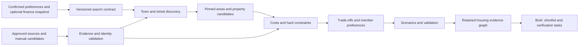

# Home Sweet Home — Engineering, Validation, and Delivery Handoff

**Parent:** [Spec 013](spec.md)\
**Date:** September 27, 2026\
**Status:** Proposed design and backlog for review; no implementation or passed acceptance evidence\
**Region contract:** [Ten-region companion](pilot-regions.md)

**First regional focus:** [Washington DC and surrounding VA/MD](dc-area-pilot.md),
confirmed September 27, 2026. DC-specific research and fixtures come first; the
remaining nine regions retain their IDs and independent admission gates.

**Next research milestone:** DEC-HOME-012 prioritizes a limited live-data test.
Read-only source checks can precede the synthetic application journey; production
adapters, external spending and real-household use retain their source and pilot
gates. The DC companion records a successful public address-source smoke check
and the unresolved listing, credential and routing dependencies. DEC-HOME-013
sets the first live-test source budget to $0, and DEC-HOME-014 excludes RentCast
from the required setup unless a no-payment, no-overage path is verified. Keyed
feeds must enforce zero-cost terms and stop before any paid or overage path is
reached.

## 1. Existing code and reuse boundary

The repository is a Python synthetic decision-support prototype. It already contains household state, financial comparison, deterministic rendering/validation, and governed evidence patterns. It does not contain a production housing search service, licensed geospatial/listing pipeline, tenant-safe household persistence, or comprehensive local jurisdiction rules.

| Existing component | Reuse candidate | Required boundary |
|---|---|---|
| [household_state.py](../../../src/kinvoryx/household_state.py) | Immutable facts, provenance, goals, source identifiers | Synthetic-only constructor remains enforced. Existing general expense categories need explicit cost-line mapping; labels alone cannot identify replaceable housing expenses. |
| [capital_allocation_optimizer.py](../../../src/kinvoryx/capital_allocation_optimizer.py) | Scenario/result and opportunity-cost patterns | Housing uses a different ledger, objective space, and time horizon; do not reuse its rates or treat its allocation result as a housing score. |
| [jurisdiction_rules.py](../../../src/kinvoryx/jurisdiction_rules.py) | Versioned jurisdiction contract pattern | Current federal prototype does not establish local property tax, rent, school, residency, or cross-state tax rules. |
| [cash_inflow_governance.py](../../../src/kinvoryx/cash_inflow_governance.py) | Case/result binding, policy/coverage fingerprints, evidence-derived readiness | Generalize through a housing-specific contract or a separately reviewed common interface. Cash-inflow approval cannot approve a housing run. |
| [cash_inflow_rendering.py](../../../src/kinvoryx/cash_inflow_rendering.py) | One retained result, household/reviewer projections | Existing Spec 011 alternatives and no-ranking presentation stay intact; optional housing preference ordering belongs only to Spec 013. |

Adopt the SDK's stable IDs, point-in-time discipline, field provenance, deterministic validation and memory format. Do not copy its runtime or introduce an agent framework without a demonstrated requirement. No multi-agent runtime is required for this feature.

## 2. Proposed architecture

Keep the first implementation modular in the existing Python package. Proposed files are design targets, not files that already exist:

```text
src/kinvoryx/housing/
  contracts.py        # typed immutable inputs, evidence, results
  costs.py            # cash ledger, financing, horizon comparison
  constraints.py      # pass / fail / unknown / unsupported
  preferences.py      # member profiles, utility anchors, contributions
  optimization.py     # frontier, optional ordering, sensitivity
  geography.py        # places, segments, coverage, address joins
  education.py        # access states, program/year verification
  employment.py       # postings versus employment context, accessibility
  discovery.py        # area recommendations and drill-down
  sources.py          # source registry and adapter contracts
  service.py          # deterministic retained-result workflow
  validation.py       # golden/property checks and evidence
  rendering.py        # briefs and accessible view projections
  governance.py       # housing evidence graph and gates
```

Begin with in-memory, synthetic fixtures and a local manual-input demo using the repository's current conventions. A pilot web UI/API, persistence, background jobs, and deployment architecture are subsequent reviewed choices; do not assume the existing local form server is safe for real households.



Adapters fetch and normalize evidence outside the pure deterministic core. A failed adapter cannot substitute language-model guesses. Separate job-posting ingestion from listing ingestion; both use rights, freshness, deduplication, and budget controls. No browser fetching is necessary to compute a result from a confirmed manual snapshot.

For live-data research, distinguish the origin of the household profile from the
origin of each external evidence record. A fictional household does not make a
live property/route/source record synthetic. Do not bypass existing household
guards or feed real household data through a `synthetic=True` flag. Record source
checks separately from housing-engine acceptance results. The DC source check
also identified a Python certificate-trust setup issue; preserve certificate
verification when implementing network clients.

For the $0 source milestone, implement provider usage controls before any keyed
adapter runs: per-source request budgets, no stored payment method dependency,
no enabled overage path, no automatic retries that can spend quota after failure,
and a `BUDGET_EXHAUSTED` state when the local cap is reached. Treat public/no-key
listing probes and no-cost developer feeds as source-quality tests, not
production inventory coverage.

## 3. Minimum data and typed contracts

### Minimum necessary inputs

| Input | Why necessary | Optionality / minimization |
|---|---|---|
| Search geography, tenure, move window, horizon | Establish candidate universe and valid comparison | Required for definitive property comparison; early exploration can leave timing unknown |
| Housing budget, upfront cash envelope | Evaluate requested cost limits and liquidity | Budget needed for cost-fit ordering; absent upfront cash means liquidity unknown, not feasible |
| Space/functional constraints | Identify relevant housing and access needs | Collect requested features only, not diagnoses or inferred household composition |
| Destinations/modes/travel times | Evaluate daily and employment access | Optional; coarse destinations for exploration, exact origins only with purpose consent |
| Education grade bands/year/program interests | Evaluate relevant school access | Optional; no dependent identity or education records |
| Job role/industry/employer interests | Evaluate additional opportunity access | Optional; no resume, private employment account, or inferred hireability |
| Member preference/veto profiles | Preserve disagreement and distribution | One profile works; additional members invite-only before shared live use |
| Existing costs, reserves, goals and obligations | Reconcile connected household effects | Optional finance snapshot with explicit selected fields and revision |
| Candidate terms and evidence | Calculate offers, not abstract area averages | Manual or licensed; incompleteness explicitly represented |

### Entity and evidence schema

| Contract | Key fields and invariants |
|---|---|
| `EvidenceValue[T]` | Value or bounds; unit; status `verified_source/user_asserted/estimated/stale/missing/conflicted/not_applicable`; source/version; effective interval, publication/retrieval/availability timestamps; confidence basis; license/purpose. `not_applicable` requires a reason, not zero substitution. |
| `HousingSearchCase` | Case/revision IDs, synthetic flag, dates/timezone, region/geometry versions, tenure set, budget/cash envelopes, baseline, member profiles, destinations, education/job interests, scenario policy, optional finance snapshot ID. |
| `PreferenceProfile` | Member ID; hard constraints; preference groups and anchors; weights; private/shared visibility; confirmation; aggregation consent. No all-zero weighted profile or undeclared scalar school metric. |
| `Constraint` | ID, owner/member, dimension, comparator, unit, threshold/date/horizon scope, evidence needs, validation and change history. |
| `HousingCandidate` | Stable property/unit/offer IDs, source IDs, address precision, coordinates and geometry IDs, tenure, type, availability, asking terms, restrictions, cost lines, evidence references. Building-level inventory cannot masquerade as a specific unit. |
| `PlaceCandidate` | Stable region/place/neighborhood/segment IDs; geometry and relationships; segment endpoints/side; residential sampling policy/seed; sample universe; tenure/property strata; source resolution and intervals. |
| `Destination` / `RouteEvidence` | Private destination ID, coordinates/precision, mode, day/time and timezone, frequency; route components, effective service, duration interval, provider, retrieval, ambiguity and permission. |
| `EducationAccess` | Candidate/origin reference, address precision, district/school/program IDs, grade and academic year, boundary/source version, eligibility route, assignment evidence, enrollment state, cost/travel references and unknowns. |
| `EmploymentEvidence` | Discriminated type `active_posting/employer_site/historical_employment/regional_occupation_context`; source/vintage, role/industry taxonomy, worksite precision, arrangement, dates/status, deduplication group and provenance. Types cannot share a generic “open jobs” count. |
| `CostLine` / `CashLedger` | Decimal amount/bounds, currency, payer, date/period, purpose, cash-versus-expense-versus-transfer classification, refundability, financing, source, paired credits. One unique ledger ID per event. |
| `FinanceBridge` | Source state ID/version, permitted fields, explicit replace/retain/add cost-line mapping, overlap dates, consent, derived candidate-state ID. Read-only source state. |
| `SourcePolicy` / `RegionCoverage` | Rights, refresh/expiry, available history, allowed transforms/export, footprint, tenure, capability, unsupported cases, owner, evidence-backed status, budget. |
| `EvaluationResult` | Candidate-level constraint records, ledger metrics, scenario results, objective values/bounds, frontier/comparability, per-member utility contributions, quality state and next checks. |
| `AreaRecommendation` | Place/segment identity, reasons, trade-offs, coverage, observation window, sample counts, cost/access intervals, job evidence types, enrollment caveats, qualifying inventory and drill-down contract. |
| `HousingDecisionBrief` | Case/policy/candidate-universe/source fingerprints, as-of, baseline, results, chosen comparison projection, full frontier count, area recommendations, excluded/pending/unsupported candidates, validation/review, limitations, replay manifest. |
| `SavedSearch` / `ChangeEvent` | Private owner, revision, confirmed notification settings, source/state diff, materiality policy, deduplication key, delivery record and revocation state. |

Validate finite numbers, units, monotone interval bounds, valid dates, academic years, nonnegative costs except explicit credits, mortgage bounds, geometry identity, and permissible source state at input. Preserve precision without converting decimal money to binary float. Cross-currency and unsupported financing/jurisdiction results remain unsupported.

Version the schemas and policies independently. Migration changes a copy and preserves the old run's permitted evidence. Hash canonical structured representations with deterministic ordering and decimal encoding; protect sensitive derived hashes and references under household authorization. Fingerprints detect changes but do not replace retained replay inputs or access control.

## 4. Service and error contracts

Proposed service entrypoints:

```text
validate_search_case(case, coverage, policies) -> InputValidation
recommend_search_areas(case, place_snapshot, evidence, policies) -> AreaResult
evaluate_housing_candidates(case, candidate_snapshot, evidence, policies) -> HousingResult
create_governed_housing_brief(retained_result, validation, reviews, coverage) -> GovernedHousingBrief
compare_housing_brief_versions(previous, current) -> DifferenceRecord
```

All source fetching is explicit and outside these pure evaluations. The service never accepts a caller-supplied “ready” boolean. Approval binds case, result, source/coverage/policy versions, validation, and review history. Editing any material input invalidates the prior approval for the new result.

Structured errors include `INVALID_INPUT`, `AMBIGUOUS_ADDRESS`, `UNSUPPORTED_MODEL`, `OUTSIDE_COVERAGE`, `MISSING_CRITICAL_EVIDENCE`, `STALE_SOURCE`, `SOURCE_RIGHTS_RESTRICTED`, `SOURCE_UNAVAILABLE`, `BUDGET_EXHAUSTED`, `NO_FEASIBLE_CANDIDATES`, and `VALIDATION_FAILED`. Each identifies scope, implicated fields/constraints, retained partial results, and next allowed action. Do not return a blank success result or fabricate a recommendation after an error.

State lifecycle: `draft → inputs_confirmed → evaluated → validated → review_pending → reviewed`. A failure produces explicit blockers; `needs_revision` returns to draft with a new revision. `stale` or `revoked` limits continued use when source rights/freshness change. A user shortlist selection is separate from domain validation, pilot authorization, and any real-world transaction. Household users do not approve their own source-validation or region launch gates.

If exposed over an API later, enforce authentication/tenant ownership on every resource, payload limits, rate limits, CSRF protection where applicable, source-URL allowlists with SSRF defenses, output escaping, idempotency for saved runs/events, and optimistic revision checks. File/URL import remains a separately permissioned adapter and must not fetch local/private network locations or execute source content.

## 5. Optimization implementation notes and trade-offs

- A transparent enumeration and Pareto filter are sufficient for the first bounded candidate set. Do not introduce a general mathematical solver or ML ranking until constraints and evaluation cost justify it.
- Compare all eligible candidates, not just the first map page. If a provider or cost cap truncates retrieval, expose queried scope, total-known versus retrieved counts, and whether frontier coverage is partial. Pagination or display zoom must not silently alter score normalization or declare global optimality.
- Keep named family/property dimensions separate from source-quality measures. An area with a sparse job feed is unknown, not job-poor. Missing school metrics do not lower a neighborhood's utility.
- Weighted ordering follows confirmed anchors and uses the same objective set across candidates. A deterministic unit test covers addition/removal of irrelevant alternatives, missing values, correlated submetrics, and tie presentation.
- Area sampling records universe, strata, sample points, weights and seed. Equal origin weights are a disclosed exploration convention, not household prevalence or population weighting. Never choose only origins that make an area look good. A street's point geometry cannot safely represent both sides of an enrollment boundary.
- Route enrichment should cache permitted nonpersonal/public components separately from private origin/destination queries. Do not share a private routing cache across tenants merely because coordinates hash identically.
- Use basic deterministic sensitivity first. Monte Carlo requires an approved joint model, calibration, reproducible seeds, and separate acceptance criteria; scenario counts are not probabilities.
- AI is optional. Template rendering must preserve full core utility, provenance, and workflow if the model is unavailable or budget is exhausted.

## 6. Acceptance and traceability matrix

Each row names a planned test/evidence target. All are **not implemented / not run**. Task IDs below are proposed and may split into tickets without renumbering requirements or acceptance criteria.

| Acceptance ID | Requirement | Testable acceptance / evidence target | Task |
|---|---|---|---|
| AC-HOME-001 | REQ-HOME-001 | `test_tenure_and_baseline`: buy/rent/mixed cases use common dates; unavailable renewal is not feasible; unsupported loan/property types stay labeled; waiting includes a housing plan. | T-HOME-002 |
| AC-HOME-002 | REQ-HOME-002 | `test_finance_bridge`: standalone evaluates only supplied envelopes; connected snapshots replace mapped ending costs once, retain overlap/obligations, and leave original state unchanged. | T-HOME-007 |
| AC-HOME-003 | REQ-HOME-003 | `test_preference_contract`: vetoes cannot be offset by utility; aspiration differs from hard limit; conflicting members remain visible; all-zero weights fail only weighted sorting. | T-HOME-002, T-HOME-005 |
| AC-HOME-004 | REQ-HOME-004 | `test_identity_and_geography`: same street name/different town, same building/different unit, and ambiguous boundary join never merge silently; outside coverage is explicit. | T-HOME-008 |
| AC-HOME-005 | REQ-HOME-005 | `test_candidate_adapter`: manual and licensed fixtures normalize consistently; expired/withdrawn offers remain unavailable; missing rights block prohibited display/export/fetch. | T-HOME-009 |
| AC-HOME-006 | REQ-HOME-006 | `test_cost_ledgers`: rent concession/deposit and mortgage/escrow/maintenance/financed-fee fixtures reconcile to cents; maximum monthly demand differs from effective rent. | T-HOME-003 |
| AC-HOME-007 | REQ-HOME-007 | `test_common_horizon`: no double-counted equity/opportunity cost; zero-rate mortgage and early exit fixtures reconcile; unavailable/multiple break-even crossings are labeled. | T-HOME-004 |
| AC-HOME-008 | REQ-HOME-008 | `test_routes`: round trips and shared legs reconcile per member/household; time-window and mode changes invalidate mismatched routes; straight-line distance never satisfies a time cap. | T-HOME-010 |
| AC-HOME-009 | REQ-HOME-009 | `test_education_access`: nearest school, directory match, old year, district-only polygon, choice eligibility, and listing school labels do not become enrollment guarantees; disabling education removes its objective. | T-HOME-011 |
| AC-HOME-010 | REQ-HOME-010 | `test_property_access`: uncertain step-free access, pet rules, hazard source, and childcare seat stay unknown; inspection/user assertions keep their status; no missing hazard becomes low risk. | T-HOME-002, T-HOME-009 |
| AC-HOME-011 | REQ-HOME-011 | `test_feasibility`: known failure beats pending for supported models; interval crossing gives unknown; no-results suggestions leave original constraints unchanged. | T-HOME-005 |
| AC-HOME-012 | REQ-HOME-012 | `test_frontier_and_utility`: dominated candidate removed only on comparable evidence; interval dominance, utility contributions, stable anchors, partial universe, and visible ties satisfy the parent contract. | T-HOME-005 |
| AC-HOME-013 | REQ-HOME-013 | `test_sensitivity`: a golden case reverses under rent/horizon/weight changes; fixed-loan payments do not change under a later rate shock; unknown bounds never get fabricated probabilities. | T-HOME-006 |
| AC-HOME-014 | REQ-HOME-014 | `test_household_conflict`: one adult's better commute/another's worse job access remains visible; no aggregate ordering before consent; vetoes and private preferences preserved. | T-HOME-005, T-HOME-015 |
| AC-HOME-015 | REQ-HOME-015 | `test_search_flow`: region → town → segment → property retains constraints, pins multiple areas, compares 2–6 plus baseline, and works without a map; empty/partial/stale states demonstrated. | T-HOME-014 |
| AC-HOME-016 | REQ-HOME-016 | `test_brief_projection`: household and reviewer views contain identical authoritative values; all numerical claims trace to retained fields; export redaction and source restrictions hold. | T-HOME-014 |
| AC-HOME-017 | REQ-HOME-017 | `test_change_events`: replayed price/status/job events produce one eligible alert; no alert without opt-in; pausing/revocation stops delivery; prior results stay versioned. | T-HOME-016 |
| AC-HOME-018 | REQ-HOME-018 | `test_ten_region_registry`: exactly the ten confirmed IDs have explicit footprints, both tenure modes, capability-specific states and owners; one region's approval cannot enable another. | T-HOME-008, T-HOME-018 |
| AC-HOME-019 | REQ-HOME-019 | `test_source_policy`: future-available and expired evidence excluded from as-of definitive claims; one-to-many joins, rights revocation and retained-history gaps surfaced; source audit retained. | T-HOME-009 |
| AC-HOME-020 | REQ-HOME-020 | `test_privacy_lifecycle`: tenant isolation, consent withdrawal, hidden member data, redacted exports, expiry and backup deletion meet approved policy under negative tests. | T-HOME-015 |
| AC-HOME-021 | REQ-HOME-021 | `test_boundary_policy`: irrelevant identity/proxy inputs and sponsorship cannot change result; extracted text cannot trigger contact/application or policy changes; expert school/area explanation review passes. | T-HOME-015 |
| AC-HOME-022 | REQ-HOME-022 | `test_ai_boundary`: hallucinated cost/school/job claims are not promoted into result data; extracted constraints need confirmation; prompt injection fails; AI-off mode retains complete comparison. | T-HOME-014, T-HOME-015 |
| AC-HOME-023 | REQ-HOME-023 | `test_housing_evidence_graph`: swapping case, source, policy, coverage or result invalidates validation/approval; out-of-order review events cannot open the gate; cash-inflow evidence is rejected. | T-HOME-017 |
| AC-HOME-024 | REQ-HOME-024 | `pilot_evidence_review`: baseline usability, coverage, source spend, harm/incident signals, accountable approvals, and stop conditions are retained per region before expansion. | T-HOME-001, T-HOME-018, T-HOME-019 |
| AC-HOME-025 | REQ-HOME-025 | `test_job_access`: historical jobs never become openings; syndicated postings deduplicate; expired, unknown-worksite and remote-only postings do not inflate confirmed nearby counts; per-member/industry filters and source vintage shown. | T-HOME-012 |
| AC-HOME-026 | REQ-HOME-026 | `test_area_recommendations`: town/neighborhood/segment explanations use confirmed objectives, sparse-data suppression and sampled access; no inheritance of eligibility; empty inventory distinguished; every chosen address rechecked. | T-HOME-013 |
| AC-HOME-027 | NFR-HOME-001 | `test_replay`: canonical repeated runs match numeric results, ordering/ties and hashes; all cash ledger fixtures reconcile to $0.01. | T-HOME-003, T-HOME-004, T-HOME-017 |
| AC-HOME-028 | NFR-HOME-002 | `test_claim_lineage`: deleting any critical evidence field removes its definitive claim; every material brief and area/job claim has source/status/version. | T-HOME-009, T-HOME-014 |
| AC-HOME-029 | NFR-HOME-003 | `benchmark_housing`: 100-run fixed-host benchmark meets parent thresholds; 30-second enrichment timeout yields explicit partial results; geometry search records its own separately approved budget. | T-HOME-018 |
| AC-HOME-030 | NFR-HOME-004 | `security_review`: no cross-household read/write/export, post-revocation access, raw private logs or unprotected coordinate hashes; deletion verified in active/cache/backup lifecycle. | T-HOME-015 |
| AC-HOME-031 | NFR-HOME-005 | `accessibility_review`: automated and manual keyboard/screen-reader/mobile review covers search, errors, comparison, map alternative and export against WCAG 2.2 AA. | T-HOME-014 |
| AC-HOME-032 | NFR-HOME-006 | `fault_injection`: source/AI outages, malformed payloads, timeouts, duplicate jobs and region/source kill switches preserve truth and stop dependent alerts/results. | T-HOME-016, T-HOME-018 |
| AC-HOME-033 | NFR-HOME-007 | `cost_cap_review`: per-region approved budget and per-request usage present; unset or exceeded budget prevents additional paid queries without hidden retry spend. | T-HOME-018 |
| AC-HOME-034 | NFR-HOME-008 | `fairness_explanation_review`: equivalent permitted preferences/evidence yield identical results after irrelevant identity swaps; source availability and score contributions remain inspectable. | T-HOME-005, T-HOME-015 |

## 7. Golden examples and property checks

Fixtures are synthetic, labeled, versioned, and contain no real household data. Numerical illustrations below are specifications of expected arithmetic, not forecasts or policy defaults.

1. **Rent concession and deposit:** 12-month lease; monthly rent $2,400; month 1 free; refundable deposit $2,400 and nonrefundable fee $300 paid at time 0; no other costs; deposit fully returned at horizon; discount rate zero. Rent paid is $26,400; effective rent $2,200; maximum contractual monthly rent $2,400; entry cash $2,700; cash-cost NPV $26,700. A deposit forfeiture scenario adds $2,400 to NPV, not to every monthly payment.
2. **Zero-rate ownership reconciliation:** price $200,000; down payment $50,000; mortgage $150,000 over 120 months at zero interest; closing costs $4,000 paid from cash; other irrecoverable ownership costs $500/month; horizon 12 months; resale $200,000 with $10,000 selling costs; no appreciation, taxes on sale, escrow assets or extra expenses; discount rate zero. Payment $1,250, balance $135,000, entry cash $54,000, 12-month recurring cash $21,000, terminal net sale $55,000, cash-cost NPV $20,000. Principal is reconciled through terminal debt, never counted twice.
3. **Reserve failure:** nominally low monthly ownership cost, but entry funds and overlap break the user reserve floor; candidate is infeasible when known, even if utility is highest.
4. **Education uncertainty:** cheaper home lists a desired school, but only a district association is verified; hard school access remains pending. Future-year rezoning cannot use today's assignment as certainty.
5. **Household disagreement:** A reduces Member 1's commute but worsens Member 2's job-access set; B reverses this. Both remain visible; no automatic household preference winner.
6. **Sparse town and split street:** a town has only 4 current comparable rentals and a street crosses a school boundary; cost-fit ordering suppressed, access-only segment guidance allowed with unknown cost, each address independently checked.
7. **Jobs versus openings:** historical area employment is 10,000; two syndicated copies of one relevant current posting count as one posting; a remote-only posting and one with unknown worksite do not inflate confirmed nearby access.
8. **No feasible result:** budget, travel and space requirements conflict; show known failures and explicitly separate relaxation scenarios. Do not silently stretch the budget or hide unverified results.
9. **Stale and conflicting inventory:** duplicate sources disagree on rent/status; retain distinct conflicting offers and a verification task. Withdrawing the shortlisted unit creates a versioned change, not an unexplained new recommendation.
10. **Affordability without finances:** a standalone case with only monthly envelope produces envelope-fit comparisons; reserve months, disposable income and verified affordability remain unavailable.
11. **Cross-region discovery:** the same confirmed profile compares areas in two regions; scores retain anchors; utility does not change when a third region's inferior candidate appears. Different school metrics cannot share a numeric scale without an approved mapping.
12. **Replay and rights:** a source is later revised/revoked; a historical result remains bounded to then-available evidence where retention is allowed. If it is not, label non-replayability and remove restricted material under policy.

Properties: cost increases cannot improve the cost utility with fixed anchors; adding a strictly dominated comparable candidate cannot remove an existing frontier member; tightening a hard constraint cannot enlarge the verified feasible set under fixed evidence; missing a hard field cannot improve feasibility; an irrelevant demographic field never changes a result; renaming/reordering input candidates does not alter economic values; refinements from town to address never inherit unverified school/job/cost claims; current job counts cannot exceed distinct verified reachable active matching postings.

## 8. Proposed delivery slices and tasks

All tasks are pending. Owner roles must be assigned to people before pilot work. Each row includes a Definition of Done; passing only a slice does not satisfy the full release scope.

| Task | Slice / owner | Requirements advanced | Definition of Done |
|---|---|---|---|
| T-HOME-001 | A: Product admission / Product, Research, Domain | REQ-HOME-024 | Validate target job/buyer and baseline, minimum data, user preferences, boundaries, fallback and semantic reuse; retain REQ-EXT-001–007 review and an approved scope/plan. |
| T-HOME-002 | B: Synthetic contracts / Platform, Product | REQ-HOME-001, REQ-HOME-003, REQ-HOME-010 | Typed immutable contracts, valid/invalid synthetic fixtures, source-state enums and no real-data bypass; AC-HOME-001/003/010 evidence. |
| T-HOME-003 | B: Cash ledgers / Finance | REQ-HOME-006, NFR-HOME-001 | Independent rental/ownership fixture review, unit/rounding/timing conventions, escrow/deposit/reserve handling and reconciliation tests. |
| T-HOME-004 | B: Tenure comparison / Finance | REQ-HOME-007, NFR-HOME-001 | Common-horizon ledgers and exit scenarios, supported financing, NPV/break-even outputs, zero-rate and early-exit test evidence. |
| T-HOME-005 | B: Feasibility and preferences / Optimization | REQ-HOME-003, REQ-HOME-011, REQ-HOME-012, REQ-HOME-014, NFR-HOME-008 | Frontier, bounds/ties, stable utility anchors, explicit disagreement, no-results diagnostics and invariance evidence. |
| T-HOME-006 | B: Scenarios / Model Risk | REQ-HOME-013 | Versioned scenario inputs, reversal examples, weight sensitivity, bounded/unknown result labels and stress applicability review. |
| T-HOME-007 | B: Finance connection / Platform, Finance | REQ-HOME-002 | Read-only synthetic household bridge with explicit expense replacement/overlap, provenance and no double-counted debt. |
| T-HOME-008 | C: Geography and region registry / Geospatial | REQ-HOME-004, REQ-HOME-018 | Register all ten region IDs with gating fixtures; first build detailed DC/VA/MD polygons, segment identities, unit precision, district/city independence and boundary tests. Other regions remain research-only until their own evidence exists. |
| T-HOME-009 | C: Evidence and adapters / Data | REQ-HOME-005, REQ-HOME-010, REQ-HOME-019, NFR-HOME-002 | Manual adapter plus fake provider fixtures; rights/expiry/as-of/dedupe/join checks; permitted live adapter only after source approval. |
| T-HOME-010 | C: Routes / Geospatial | REQ-HOME-008 | Mode/window-aware synthetic route contracts, trip accounting, uncertainty and no straight-line-time substitution; later licensed provider audit. |
| T-HOME-011 | C: Education / Education, Data | REQ-HOME-009 | Address/year/grade/program states, current versus future boundaries, childcare/enrollment unknowns, district-source hierarchy and fixtures. |
| T-HOME-012 | C: Employment access / Labor Data | REQ-HOME-025 | Evidence-type separation, user role/industry filters, deduplicated active-posting and historical-context fixtures, worksite/travel handling. |
| T-HOME-013 | C: Area discovery / Geospatial, Optimization | REQ-HOME-026 | Town/neighborhood/segment graph, reproducible sampling, sparse-data gating, recommendation explanations, multi-area pins and property handoff. |
| T-HOME-014 | D: Workspace and briefs / Design, Reporting | REQ-HOME-015, REQ-HOME-016, REQ-HOME-022, NFR-HOME-002, NFR-HOME-005 | Complete synthetic flow with deterministic projections, optional AI draft confirmation, accessible map alternative, exports and all error states. |
| T-HOME-015 | E: Private pilot foundation / Privacy, Security, Model Risk | REQ-HOME-014, REQ-HOME-020, REQ-HOME-021, REQ-HOME-022, NFR-HOME-004, NFR-HOME-008 | Auth/isolation, roles, member consent, safe imports/AI, export controls, retention/deletion, fairness/expert review and approved live-data boundary. |
| T-HOME-016 | E: Saved searches and changes / Platform | REQ-HOME-017, NFR-HOME-006 | Versioned opt-in monitoring, materiality rules, idempotent alerts, pause/revoke behavior and outage evidence. |
| T-HOME-017 | E: Housing governance / Platform | REQ-HOME-023, NFR-HOME-001 | Retained housing evidence graph, replay manifest, ordered reviews, tamper/mismatch rejection and region-specific fail-closed gates. |
| T-HOME-018 | F: Readiness and operations / Data Ops, Operations | REQ-HOME-018, REQ-HOME-024, NFR-HOME-003, NFR-HOME-006, NFR-HOME-007 | Per-region source audit, benchmarks, paid-query caps, dashboards, named owners, rollback drill and signed admission evidence. |
| T-HOME-019 | F: Controlled research / Research | REQ-HOME-024 | Predeclared baseline comparison, recruitment/consent and measurement plan, region results, economics and stop/expand recommendation with evidence. |

Sequence: A precedes implementation; B precedes material C/D integration; C and D can be decomposed into reviewable vertical slices; E precedes real-household storage/sharing/monitoring; F gates each region's controlled pilot. Live source feasibility research can occur before engineering, subject to permitted use. No dates or staffing estimates are committed without scope, vendor and ownership review.

## 9. Pilot metrics, operations, and rollback

Proposed research design: start with 12–20 consented discovery participants spanning renters, buyers, mixed-tenure searches, multiple-member households, education users/nonusers, and functional accessibility needs. After gates pass, recruit at least 10 completed household sessions per activated region, aiming for at least 5 buyer and 5 renter decision tasks; a mixed-tenure session may cover both but does not count as two households. These are learning cohorts, not statistically powered impact claims.

Use counterbalanced comparable tasks against the participant's current method or a filter-plus-spreadsheet baseline with the same evidence universe. Report region and tenure results, denominator, exclusions, missing follow-ups, and uncertainty. Measure the quality of the decision process before attributing improvement to the product.

| Metric | Definition | Proposed continuation target / stop signal |
|---|---|---|
| Trade-off comprehension | Participant correctly explains two material differences and one uncertainty in their retained brief | >=80% of completed sessions; failures guide redesign |
| Time to useful shortlist | Median elapsed active task time to 2–5 user-retained candidates/areas, with constraints understood | Target >=20% improvement versus comparable baseline; report task comparability and small sample limits |
| Verification quality | Critical unknowns surfaced before declaring an option feasible | 100% in acceptance cases; any severe pilot miss pauses the affected capability |
| Source accuracy/freshness | Agreement with reviewed source and current policy among sampled material claims | 100% for critical identity/school/cost claims or explicitly unknown; no silent stale definitive claims |
| Town/street usefulness | Participant can explain why a recommended area fits and successfully narrow to verified address checks | >=80%; no precision claim unsupported by source resolution |
| Job evidence comprehension | Participant distinguishes historical employment, active postings and guaranteed offers | >=90% among sessions using job access; investigate any design encouraging conflation |
| Household fairness | All participating adults can see their own burdens/vetoes and understand any agreed aggregation | 100% consent and visibility checks; disagreement is an outcome, not a failure |
| Operating cost | Listing/geocode/route/job/API/AI/storage spend per completed comparison and per region | Within a named approved budget; no arbitrary dollar target until supplier quotes |
| Privacy and reliability | Confirmed unauthorized data exposure, source-policy breach or unsupported definitive conclusion | Zero severe incidents; pause immediately on detection |
| Longer-term usefulness | Optional 30/90-day feedback on unexpected costs, missed access constraints and satisfaction | Descriptive learning only; do not claim causal savings or school/career outcomes |

Telemetry uses opaque run/region/capability IDs, durations, provider status, spend, aggregate missingness, and error counts. No precise addresses, private routes, budgets, child details, raw source text or profiles. Internal operations should track critical-field missingness, stale listings, deduplication conflicts, geocode/education ambiguity, active-job expiry, comparison failure, blocked gates, alert volume and per-source costs by region/tenure.

Proposed alert thresholds: any rights/privacy/critical numerical violation pages the accountable owner and disables the affected path; provider failures above 5% of at least 100 requests in 15 minutes trigger review and degraded mode; stale critical evidence affecting more than 10% of evaluated candidates in the same window triggers Data Ops review, while each stale candidate is already individually gated. Lower-volume pilots use daily review and immediate critical-event escalation rather than pretending aggregate rates are statistically stable. Operations must approve actual on-call coverage before activation.

Rollback controls: disable housing globally, by region, source, capability, or engine/policy version; halt dependent queued alerts; preserve allowed user notes and prior briefs with stale/revoked status; revert to the last validated version only if its evidence and source rights remain valid. Notify affected users through the implemented product workflow after an accountable incident decision. Reopening requires an incident record, corrected evidence, relevant acceptance reruns and owner approval.

## 10. Handoff checklist and next review

Documentation deliverables are the parent spec, confirmed ten-region list with proposed boundaries, contracts/architecture proposal, traceable tests/tasks, risk and metric definitions, master handoff links, and metadata-only repo memory. They are ready for discussion; execution readiness is not asserted.

The next product review should resolve the DC core/outer-ring footprint, concrete preference questions, first activated cohort, source budgets and owners. Bay Area and Dallas footprint decisions remain on the later-region backlog and do not block DC. Domain review should challenge cash/equity/escrow treatment, school/childcare access semantics, job evidence types, geographic sampling and sparse-data thresholds. Engineering review should validate contract reuse and benchmark targets before approving a plan. No existing application code needs to change to complete this specification handoff.

## 11. Documentation verification record

September 26, 2026 handoff checks confirmed sequential, unique definitions for
26 functional requirements, 8 NFRs, 34 acceptance criteria, 19 proposed tasks and
10 region IDs; each requirement has both acceptance and task coverage. All 97
local links inspected across the handoff and linked index/memory documents
resolved. Markdown structure, new memory YAML/required metadata, and the two
numerical ledger examples passed independent checks. `git diff --check` passed;
application source and tests were unchanged.

These results validate documentation integrity and the stated illustrative
arithmetic only. They are not housing-engine test results, source coverage
validation, or pilot approval. Application tests were not run for this
documentation-only change. This record captures verification before committing
the handoff.

## 12. DC-first planning refinement — September 27, 2026

DEC-HOME-011 confirms HOME-REG-003 as the first focus. The DC companion adds
proposed source investigations, geographic tiers, preference research, delivery
checkpoints and twelve local benchmark cases mapped to existing tasks and
acceptance criteria. The 26 requirements, 8 NFRs, 34 acceptance criteria and
19 task IDs are preserved. The September 26 verification record above describes
the original handoff; source/implementation/pilot validation remains pending.
